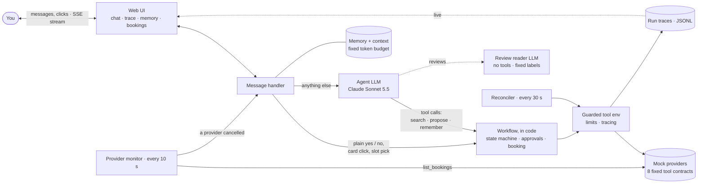
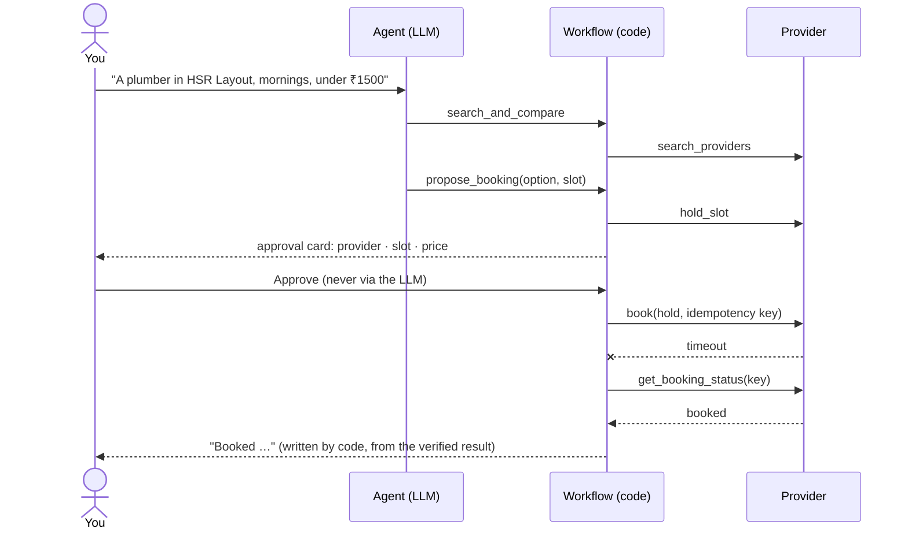

# Errand Agent

A chat agent that arranges home services (plumber, electrician, AC servicing, cleaning,
carpenter). It asks only for what's missing, compares providers, and books, cancels or
reschedules **only after you approve the exact provider, slot and price**. Approval is
enforced in code, not in the prompt. Providers are local mocks with realistic failures
(timeouts, taken slots, price changes, cancellations).

**The core rule: the LLM proposes, the workflow decides.** The model has no tool that books
or approves anything. It can search and propose; code holds the slot, shows an approval
card, and acts only on your "yes" or click, with idempotent retries and a check of the
provider's records whenever an outcome is unclear.

## Quick start

> **An LLM API key is required to run the app.** Put it in `backend/.env` (gitignored,
> never committed).
> - **Default: Anthropic.** `ANTHROPIC_API_KEY` alone is enough (Claude Sonnet 5.5 runs
>   the agent, Claude Haiku 5.5 reads reviews).
> - **Other providers:** set `ERRAND_MODEL` and that provider's key, e.g.
>   `ERRAND_MODEL=openai:gpt-6.1-sol` with `OPENAI_API_KEY`.
> - **Only Anthropic models have been tested.** Others should run, but we can't vouch for
>   the same behaviour. The effort and prompt-caching settings apply to Anthropic only.
>
> Tests and evals run offline against a scripted model and need no key.

Also needs [uv](https://docs.astral.sh/uv/) and [bun](https://bun.sh/).

```sh
make install                                 # backend + frontend dependencies
cp backend/.env.example backend/.env         # then set ANTHROPIC_API_KEY=...
make demo                                    # app on http://localhost:5173, with the Demo tab
```

`make dev` is the same without the Demo tab. `make chat` is a terminal chat instead of the
web UI. Tests and evals need **no key**: they run offline against a scripted model.

## Try it

1. **Book:** "Find me a plumber in HSR Layout this week, mornings, under ₹1500." Pick a
   time on the slots card, then press **Approve**.
2. **Break it on purpose:** in the **Demo** tab, arm *Times out after succeeding* or *Slot
   taken*, then approve a booking. The agent checks the provider's records before it
   claims anything; the **Trace** tab shows each step.
3. **Proactive follow-up:** Demo tab → *Provider cancels*. Within ~10 s the agent tells
   you, and proposes a replacement within your saved preferences, for you to approve.
4. **Memory:** "never before 10 am" is remembered across sessions. Inspect, correct or
   forget anything in the **Memory** tab.

## How it works



Only the workflow can touch a provider, and it books only on an approval. A booking from
request to confirmation, including a timeout the agent recovers from:



- **Approvals:** each card is fingerprinted (provider, slot, price). Any change voids it,
  and a stale click is refused.
- **Booking correctness:** one idempotency key per approved booking. After a timeout the
  provider's status is checked before any retry; a background reconciler settles anything
  left unknown, including after a crash.
- **Untrusted text:** provider reviews are read only by a separate model with no tools,
  which can answer with fixed labels only. A model reply that claims an unverified
  booking gets a code-written correction.
- **Memory:** explicit vs inferred facts, with the user's own words as evidence. Inferred
  facts stay out of the model's context until you confirm them; forgotten ones never
  return.
- **Context:** a fixed per-request token budget (7,500 tokens). Every request logs what
  was sent and what was left out.
- **Proactive:** a monitor reads `list_bookings` every 10 s and handles each provider
  cancellation exactly once.
- **Bounded:** limits on model turns, tool calls and wall-clock time. Every exit ends in
  a clear message.

Models: by default Claude Sonnet 5.5 drives the agent and Claude Haiku 5.5 reads reviews
(low effort, prompt caching: D5). Any model can be configured, but only Anthropic models
have been tested.

## Tests and evals

```sh
make test     # backend + frontend tests, including all 25 eval scenarios (offline)
make evals    # the eval scenarios, writing the results table to evals/results.md
make smoke    # one real conversation with the real model (~$0.05; needs a key)
make lint     # ruff, pyright, oxlint, tsc
```

The **25 eval scenarios** ([results](evals/results.md)) cover the assignment's list:
- approval and repeated confirmation
- prompt injection and a deliberately misbehaving model
- timeout after success, a slot taken, a slot conflict, tool failures
- a restart mid-booking
- memory correction and forgetting
- proactive cancellation, the context budget, limit exhaustion

Every scenario also checks six invariants, starting with *no booking without a matching
approval*.

## Docs

| | |
|---|---|
| [docs/ARCHITECTURE.md](docs/ARCHITECTURE.md) | the map: one turn step by step, each component's guarantee, the state machine |
| [docs/COMPONENTS.md](docs/COMPONENTS.md) | every component in detail: what, why, how |
| [docs/DECISIONS.md](docs/DECISIONS.md) | design decisions D1–D7, with the evidence behind them |
| [BUGS.md](BUGS.md) | 12 real bugs: what broke, why, the fix, the regression test |
| [evals/results.md](evals/results.md) | the generated eval table |
| [TASKS.md](TASKS.md) | build plan and progress |

## Layout

| Path | What's there |
|---|---|
| `backend/src/errand_agent/agent/` | the LLM agent: tools, prompts, review reader, claim check |
| `backend/src/errand_agent/workflow/` | state machine, approvals, booking, reconciler, provider monitor |
| `backend/src/errand_agent/memory/` | memories, context selection, the seeded demo user |
| `backend/src/errand_agent/mocks/` | the mock provider world: 8 tool contracts, scripted failures |
| `backend/src/errand_agent/tracing/` | run traces and cost |
| `backend/src/errand_agent/api/` | FastAPI routes, SSE streams, terminal chat |
| `backend/tests/` | `unit/`, `evals/` (25 scenarios + harness), `smoke/` (live model) |
| `frontend/src/` | the web UI: chat, slots card, Trace / Memory / Bookings / Demo tabs |

Backend: Python 3.12 · uv · FastAPI · PydanticAI · SQLite. Frontend: bun · Vite · React ·
TypeScript · Tailwind · shadcn/ui. Settings live in `backend/.env`
([example](backend/.env.example)); runtime data (SQLite databases, JSONL traces) goes to
`backend/var/`.
