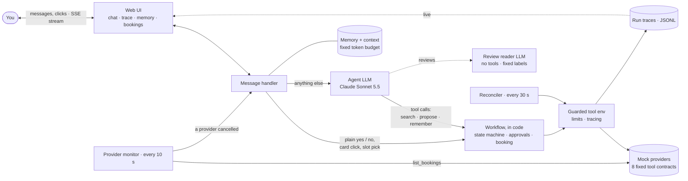
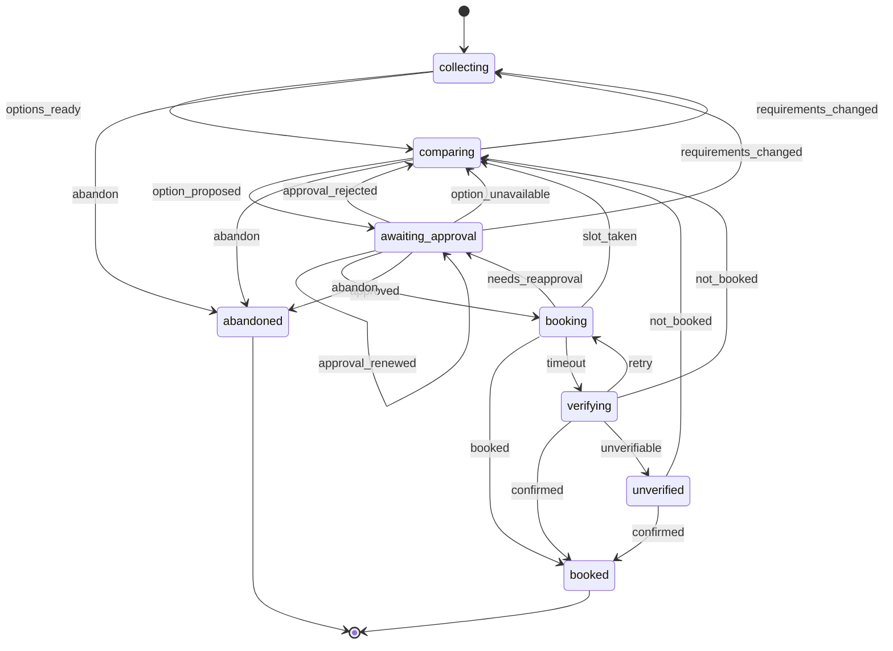
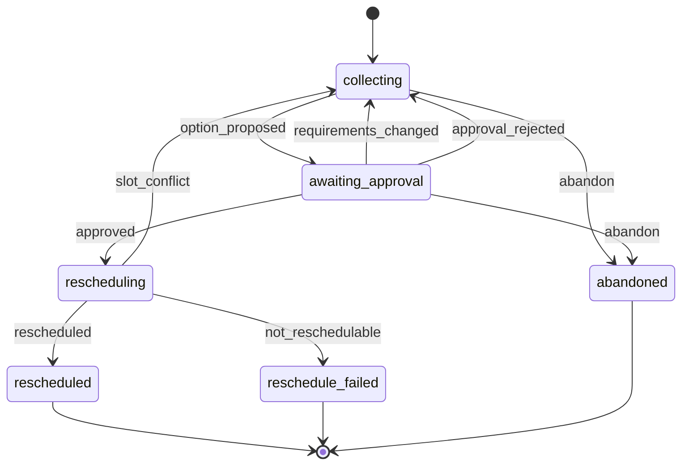
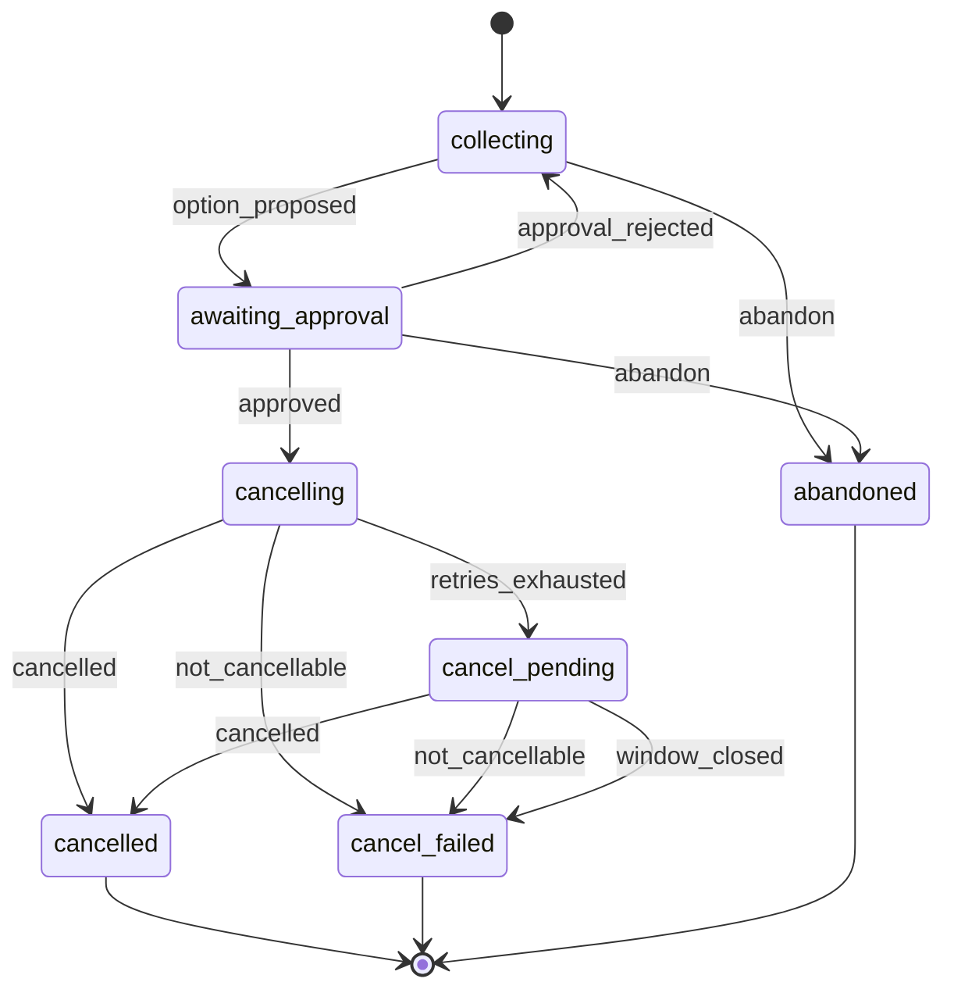

# Architecture

A map of the Errand Agent: how it fits together and what each part guarantees. **Why**
the less obvious choices were made is in [DECISIONS.md](DECISIONS.md) (D1–D7); each
component's full detail is in [COMPONENTS.md](COMPONENTS.md) and in its module docstring
(What / Why / How).

## The core rule: the LLM proposes, the workflow decides

The model understands requests and proposes actions. Deterministic code decides whether
an action runs: it checks approvals, holds, limits and idempotency, and is the only code
that can book, cancel or reschedule. Approval is enforced by code, never inferred from
model output, so nothing a provider's review says can grant permission.



## One turn, step by step

1. **Settle first.** The reconciler finishes anything this session left unknown (a booking
   whose outcome was lost, a cancel that got a 503), so the turn starts from the
   provider's truth.
2. **Save the message** before anything runs, so it survives a crash.
3. **A plain yes or no is decided in code.** "yes" with exactly one card waiting grants
   that approval; "no" declines it. No model is involved. A card click or a slot pick
   arrives on its own route and is also decided in code.
4. **Anything else goes to the model**, with a context built under a fixed token budget:
   the system prompt, a state summary, only relevant and current memories, and this
   session's recent messages. What was sent, and what was left out and why, is logged
   (`context_sent`).
5. **The model calls tools.** They search, rank, hold a slot and create an approval card,
   but none of them books. Every call is traced and counted against the run's limits.
6. **Approval** (a later "yes" or click) runs the booking flow: one idempotency key per
   approval; on a timeout, ask the provider's status before any retry; never claim
   success until it is verified.
7. **The reply** is code-written for any booking outcome. A model's reply is checked
   against verified state, and a false "booked" gets a code-written note (BUG-12).
8. **Every exit**, including limits and errors, ends with a saved message and a finished
   trace.

## Components

Every component has a What / Why / How docstring; [COMPONENTS.md](COMPONENTS.md) has the
long form.

**Agent** (`agent/`): the LLM side, which can only propose.

| Component | What it guarantees |
|---|---|
| `handler.py` | the single entry point: typed yes/no decided in code, model turns, card decisions, slot picks, provider-cancellation runs; every exit saved and traced |
| `tools.py`, `orchestrator.py` | the model's tools: update requirements, search and compare, propose (hold + card), cancel/reschedule requests, memory; none books |
| `review_reader.py` | the only model that reads untrusted reviews: no tools, fixed labels only (Dual LLM) |
| `claims.py` | a reply claiming an unverified booking gets a code note (BUG-12) |
| `loop.py`, `budget.py` | the run loop with streaming; a guard keeps every request within the token budget |
| `models.py`, `prompts.py` | model factory (Anthropic default; effort and caching: D5); the system prompt |

**Workflow** (`workflow/`): code that decides, and the only code with side effects.

| Component | What it guarantees |
|---|---|
| `errands.py` | the explicit state machine; any illegal move raises (diagrams below) |
| `approvals.py` | approvals fingerprinted on provider, slot and price; any change voids one; typed yes/no vocabulary |
| `booking.py` | hold → approval → book with one idempotency key; after a timeout, status before retry; at most 3 attempts |
| `changes.py` | cancel and reschedule, each approved; retries a 503 with the same key |
| `reconciler.py` | settles every unknown outcome from the provider's truth, never by booking again |
| `monitor.py` | notices provider cancellations via `list_bookings`, handles each exactly once (D6) |
| `guarded_env.py` | every provider call traced and counted against model-turn, tool-call and wall-clock limits |
| `ranking.py`, `requirements.py` | ranked options (rating adjusted for how many reviews it rests on); only missing details are asked |
| `context.py`, `outcomes.py` | the per-request context packet; every run ends in a clear outcome (with alternatives after a lost slot: BUG-11) |

**Memory and context** (`memory/`)

| Component | What it guarantees |
|---|---|
| `store.py` | explicit vs inferred facts; a quote from the user's own message is required (provenance); explicit beats inferred; correct, forget |
| `selection.py`, `tokens.py` | only relevant, current memories, within their own budget; calibrated token estimates that never undercount (BUG-7) |
| `inference.py` | suggestions from booking history, kept out of the model's context until confirmed (D2) |
| `conversation.py`, `scrub.py` | session-scoped history; forgetting also scrubs the words from stored messages |
| `profile.py` | contact details reachable only through profile tools, never traced by value |
| `seedgen.py`, `seed.py` | the demo user: 55 memories, 200 messages over 10 earlier sessions |

**Providers and mocks**

| Component | What it guarantees |
|---|---|
| `providers/` | the 8 fixed tool contracts (`ToolEnv`); business outcomes are typed results, transport failures are exceptions |
| `mocks/world.py` | the mock provider world: idempotent `book`, timeouts that commit first, a 503 on the first cancel, double booking impossible in the database |
| `mocks/scenario.py` | keyed randomness (70 / 15 / 7.5 / 7.5) and scripted outcomes, so every run is reproducible |
| `mocks/control.py` | the demo's control plane (provider cancels, scripted failures), never visible to the agent |
| `mocks/data/providers.json` | 30 providers, with prompt-injection reviews planted to prove the defences |

**Tracing** (`tracing/`): one JSONL trace per run (state transitions, model and tool
calls with sanitized arguments and results, tokens, latency, cost including prompt
cache). See [Run lifecycle](#run-lifecycle).

**API** (`api/`): FastAPI wiring and background loops (`app.py`), chat over SSE
(`chat_routes.py`), the live push stream and past runs (`trace_routes.py`), memory and
bookings (`memory_routes.py`), demo controls (`demo_routes.py`), proactive notices
(`proactive.py`), and the terminal chat (`chat.py`).

**Web UI** (`frontend/`): chat with streamed replies, approval cards and a Calendly-style
slots card, beside Trace, Memory, Bookings and Demo tabs (D4).

**Evals** (`backend/tests/evals/`): 25 scenarios through the real agent with a scripted
model, each checking six invariants (below); `make evals` writes
[evals/results.md](../evals/results.md); `make smoke` runs the real model once (D7).

## Errand state machine

Each request is an errand with an explicit state. Every legal move is a row in a table
(`workflow/errands.py`); anything else raises `InvalidTransition`. The diagrams are
generated from that table, and a test fails if they drift.

| Group | States | Meaning |
|---|---|---|
| Terminal | `booked`, `rescheduled`, `reschedule_failed`, `cancelled`, `cancel_failed`, `abandoned` | no exits |
| In flight | `booking`, `verifying`, `rescheduling`, `cancelling` | a provider side effect is running |
| Parked | `unverified`, `cancel_pending` | waiting for the reconciler |
| Abandonable | `collecting`, `comparing`, `awaiting_approval` | the user can drop it |

**book**



**reschedule**



**cancel**



## Invariants the evals check

After every eval scenario (`backend/tests/evals/harness.py`), each proven able to fire:

1. Every booking traces to a consumed approval for exactly that provider, price and slot.
2. At most one booking per errand.
3. Every run ends with an outcome (never `unspecified`) and a saved reply.
4. No context ever held a memory that was forgotten, replaced, rejected or unconfirmed.
5. Every request's context stays within its token budget.
6. Every run stays within its model-turn and tool-call limits.

## Run lifecycle

A **run** is one inbound event handled end to end: a message, a click, a slot pick, a
reconcile pass or a provider cancellation. Each writes `var/traces/<run_id>.jsonl`, one
event per line (`{ts, run_id, session_id, seq, type, ...}`), so a partial trace survives a
crash. A run ends exactly once: with its outcome, with `error` if an exception escaped,
or never (the process died: detectable after restart).

| Event | Payload |
|---|---|
| `run_started` / `run_finished` | trigger / outcome, totals (calls, tokens, cost, duration) |
| `state_transition` | `from`, `to`, event, reason |
| `context_sent` | budget and tokens per section, memories included and excluded (with reasons), messages included / dropped / out of scope |
| `model_call` | model, input / output / cached tokens, our estimate, latency, cost |
| `tool_call` / `agent_tool` | a provider call / one of the agent's own tools: arguments, result, status, latency |
| `approval`, `memory`, `profile` | approval and memory changes; profile field names only, never values |
| `provider_cancellation`, `notice_decision` | the monitor saw a cancellation; what it decided and why (D6) |
| `claim_corrected` | a reply claimed what wasn't verified; a note was added (BUG-12) |
| `limit_hit`, `error` | which limit, or the error |

## Layers and import rules

An import is the only way one module can call another, so the dependency direction is
the enforcement. `backend/tests/unit/test_layering.py` parses every module and fails on
an import outside these rules:

| Layer | May import |
|---|---|
| `core/` | nothing internal |
| `store/`, `tracing/` | `core` |
| `providers/` | `core` (the contract: `ToolEnv`, models, errors) |
| `mocks/` | `core`, `store`, `providers` |
| `memory/` | `core`, `store`, `tracing`, `providers` |
| `workflow/` | `core`, `store`, `tracing`, `memory`, `providers` |
| `agent/` | `core`, `store`, `tracing`, `memory`, `providers`, `workflow` |
| `api/` | everything |

Only `api/` may import `mocks/`: everything else sees providers through the contract, so
no code can peek at the mock's database to decide what happened. (`proactive/` has a rule
but is empty: the provider monitor needs only the contract and the stores, so it lives in
`workflow/`.)

## Settings and runtime data

Settings come from `backend/.env` ([example with every option](../backend/.env.example)),
validated at startup. Runtime data lives under `backend/var/` (gitignored):

```
var/
├── agent.db         # our state: errands, approvals, idempotency keys, memory, messages
├── mock_world.db    # the simulated providers (a separate file: it survives agent restarts)
└── traces/<run_id>.jsonl
```

Two databases on purpose: "restart mid-booking" needs the provider to remember a booking
that succeeded while the agent's process died.
